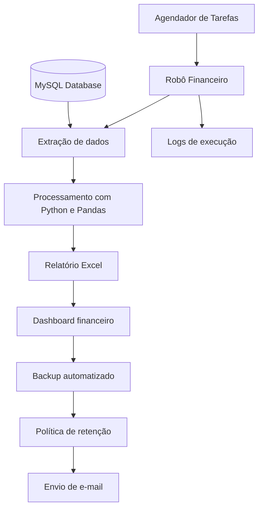
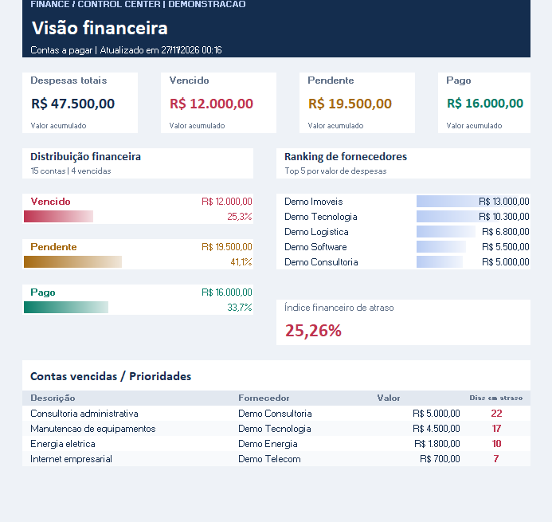
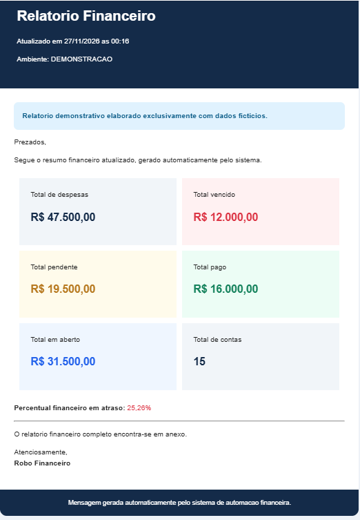
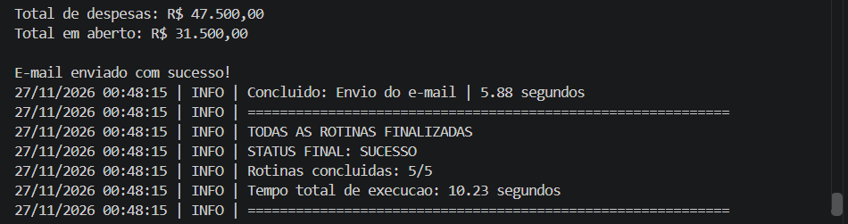

# Robô Financeiro | Automação e Análise de Dados


## Sobre o projeto

O Robô Financeiro é uma solução de automação de
processos financeiros desenvolvida em Python e MySQL,
com foco em análise de dados, controle de contas a
pagar e geração automatizada de relatórios gerenciais.

O projeto simula um ambiente empresarial, integrando
banco de dados, processamento de informações,
indicadores financeiros, dashboards em Excel,
gerenciamento de backups e envio automático de e-mails.

## Objetivos

- Automatizar atividades financeiras repetitivas.
- Reduzir a necessidade de processamento manual.
- Centralizar informações financeiras.
- Monitorar contas vencidas e pendentes.
- Apoiar a tomada de decisões gerenciais.
- Garantir a rastreabilidade das execuções.
- Aplicar boas práticas de segurança da informação.

## Tecnologias utilizadas

| Tecnologia | Aplicação |
|---|---|
| Python | Desenvolvimento e automação |
| MySQL | Armazenamento de dados |
| SQL | Consultas e indicadores financeiros |
| Pandas | Tratamento e análise de dados |
| OpenPyXL | Relatórios e dashboards em Excel |
| Keyring | Armazenamento de credenciais |
| SMTP / SSL | Envio seguro de e-mails |
| Logging | Monitoramento de execuções |
| Task Scheduler | Agendamento automático |
| Git e GitHub | Controle de versão |

## Arquitetura da solução



## Funcionalidades

- Conexão com banco de dados MySQL.
- Extração automatizada de contas a pagar.
- Processamento e análise de dados financeiros.
- Geração de relatórios em Excel.
- Dashboard financeiro gerencial.
- Ranking de fornecedores por valor de despesas.
- Identificação de contas vencidas.
- Cálculo de dias em atraso.
- Envio automático de relatórios por e-mail.
- Backup com identificação de data e horário.
- Política de retenção de backups de 30 dias.
- Modo de simulação para exclusão de backups.
- Registro de logs e tratamento de erros.
- Monitoramento do tempo de execução.
- Agendamento de rotinas financeiras.
- Separação entre ambientes real e demonstrativo.

## Dashboard financeiro

Dashboard gerencial desenvolvido em Python e OpenPyXL,
com indicadores financeiros, distribuição de despesas,
ranking de fornecedores e monitoramento de contas vencidas.



*Ambiente demonstrativo com dados fictícios.*

## Envio automático de relatórios por e-mail

O sistema realiza o envio automatizado de relatórios
financeiros por e-mail, utilizando SMTP com conexão
segura SSL, indicadores em HTML e o relatório Excel
em anexo.



*Relatório automático gerado em ambiente demonstrativo.*

## Execução automatizada

O robô financeiro executa cinco rotinas integradas,
com monitoramento de logs, tratamento de exceções,
controle de falhas e registro do tempo de execução.



*Teste realizado em ambiente demonstrativo, com 100%
das rotinas concluídas em 10,23 segundos.*

## Indicadores financeiros

O ambiente demonstrativo utiliza dados fictícios
para apresentar o funcionamento da solução.

| Indicador | Resultado |
|---|---:|
| Total de contas | 15 |
| Total de despesas | R$ 47.500,00 |
| Total vencido | R$ 12.000,00 |
| Total pendente | R$ 19.500,00 |
| Total pago | R$ 16.000,00 |
| Total em aberto | R$ 31.500,00 |
| Contas vencidas | 4 |
| Percentual financeiro em atraso | 25,26% |

## Estrutura do projeto

```text
robo_financeiro/
│
├── conexao.py
├── configurar_senha.py
├── configurar_email.py
├── consulta_financeira.py
├── relatorio_financeiro.py
├── exportar_excel.py
├── dashboard_financeiro.py
├── dashboard_v3.py
├── backup_relatorio.py
├── limpar_backups.py
├── enviar_email.py
├── robo_financeiro.py
├── schema.sql
├── dados_demo.sql
├── requirements.txt
├── .gitignore
└── README.md
```

## Instalação e configuração

### 1. Pré-requisitos

- Python 3.14
- MySQL Server
- MySQL Workbench
- Git
- Conta Gmail para envio de relatórios

### 2. Instalar as dependências

No terminal, dentro da pasta do projeto:

```bash
pip install -r requirements.txt
```

### 3. Configurar o banco de dados

Execute os seguintes arquivos no MySQL Workbench,
respeitando a ordem:

1. schema.sql
2. dados_demo.sql

O ambiente demonstrativo utiliza o banco:

```text
empresa_automacao_demo
```

### 4. Configurar as credenciais

Execute:

```bash
python configurar_senha.py
python configurar_email.py
```

As credenciais são armazenadas por meio da biblioteca
Keyring, evitando senhas diretamente no código-fonte.

Para o Gmail, utilize uma senha de aplicativo,
quando disponível na configuração da conta.

### 5. Selecionar o ambiente demonstrativo

No PowerShell:

```powershell
$env:DB_NAME = "empresa_automacao_demo"
```

### 6. Testar a conexão

```bash
python conexao.py
```

### 7. Executar a automação completa

```bash
python robo_financeiro.py
```

## Fluxo de execução

O robô executa cinco rotinas sequenciais:

1. Exportação financeira.
2. Geração do dashboard.
3. Backup do relatório.
4. Limpeza de backups.
5. Envio do e-mail.

Caso uma rotina apresente falha, o sistema interrompe
a sequência e registra o erro nos logs de execução.

## Segurança da informação

O projeto aplica práticas de proteção de dados:

- Credenciais armazenadas fora do código-fonte.
- Utilização de conexão SMTP com SSL.
- Separação entre ambientes real e demonstrativo.
- Exclusão de relatórios privados do versionamento.
- Proteção de logs e backups por meio do .gitignore.
- Utilização de dados fictícios no ambiente público.
- Modo de simulação para exclusão de arquivos.

Nenhuma credencial real deve ser adicionada ao
repositório.

## Agendamento automático

A automação pode ser integrada ao Agendador de
Tarefas do Windows, permitindo a execução diária
das rotinas financeiras sem intervenção manual,
desde que os serviços e as credenciais estejam
disponíveis no ambiente de execução.

## Resultados dos testes

- Conexão com MySQL validada.
- Consultas financeiras executadas.
- Exportação de 15 registros demonstrativos.
- Dashboard financeiro gerado.
- Backup automatizado validado.
- Política de retenção testada.
- Envio de e-mail confirmado.
- Execução pelo Agendador de Tarefas validada.

Em um dos testes integrados, todas as cinco rotinas
foram concluídas com sucesso em 13,65 segundos.

## Competências aplicadas

- Análise de dados.
- Business Intelligence.
- Automação de processos.
- Programação em Python.
- Consultas SQL.
- Modelagem de banco de dados.
- Indicadores de desempenho (KPIs).
- Gestão financeira.
- Tratamento de exceções.
- Segurança da informação.
- Controle de versão.
- Documentação técnica.

## Melhorias futuras

- Integração com Power BI.
- Dashboard interativo via aplicação web.
- Implantação em ambiente de nuvem.
- Testes automatizados.
- Integração com APIs financeiras.
- Monitoramento avançado de execuções.
- Centralização das configurações do sistema.

## Autor

**Caio Alves da Fonseca**

Projeto de portfólio profissional desenvolvido
com foco em Tecnologia, Análise de Dados,
Automação de Processos e Business Intelligence.